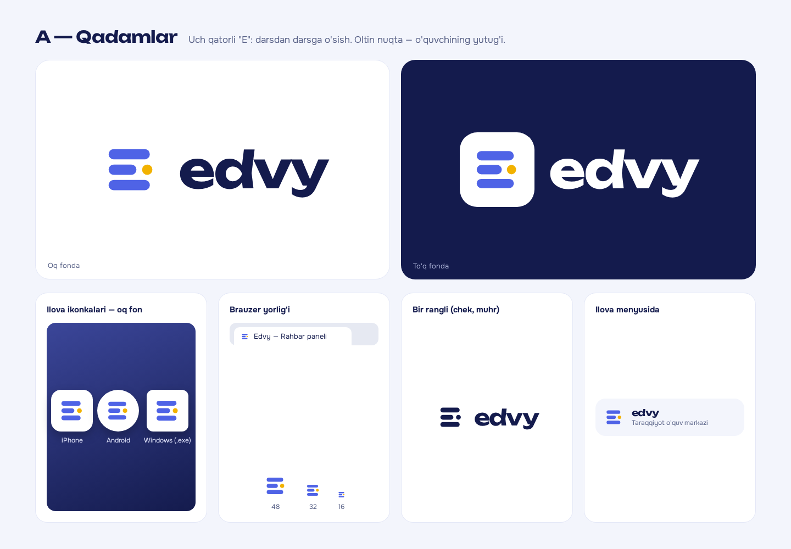
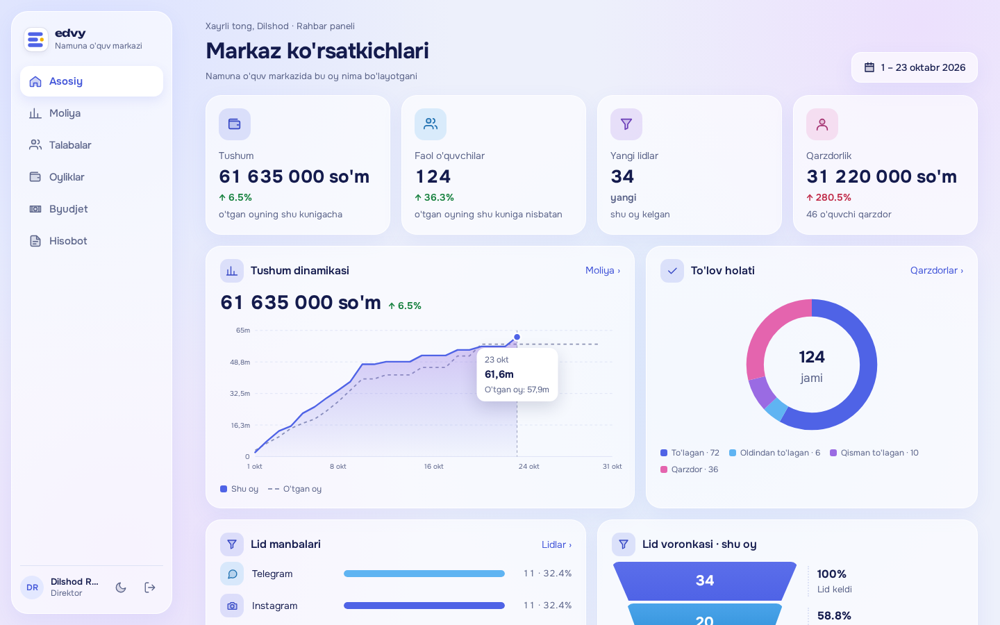
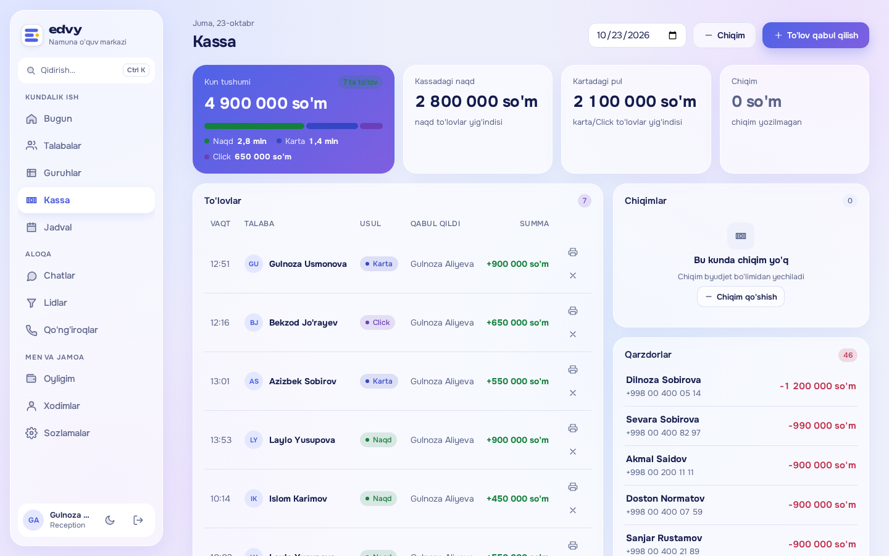
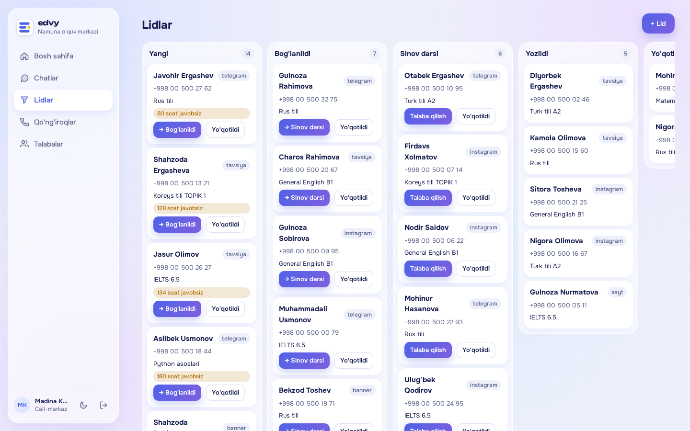
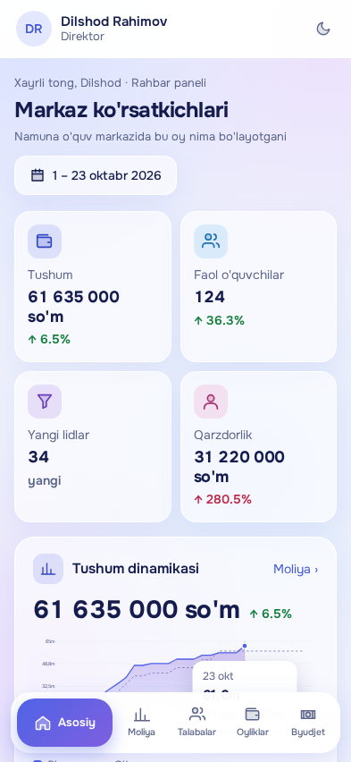
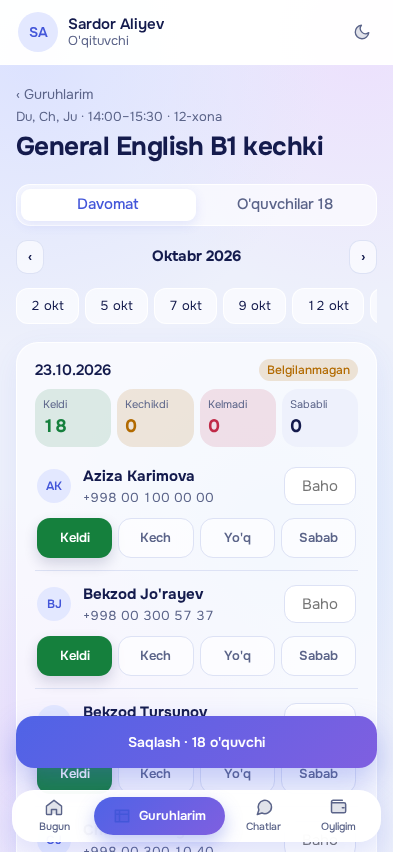
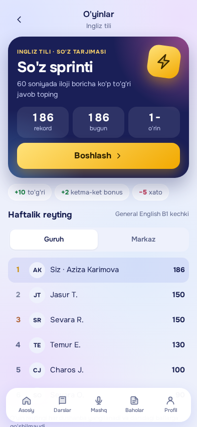
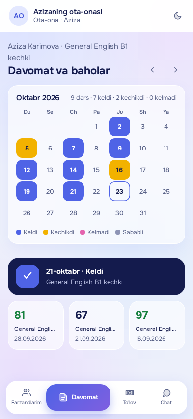

# Edvy — dizaynlar va Reels video materiallari

Edvy — o'quv markazlar uchun CRM, ilova va AI: kassa, qarz, davomat, oylik, lidlar, ota-ona va o'quvchi ilovasi.
Hozir **Taraqqiyot Chorsu** va **DLola filiallari**da, **1000+ o'quvchi** bilan ishlaydi.

Ekranlardagi ismlar, raqamlar va summalar namuna markazniki — real o'quvchi ma'lumoti yo'q.

## Papkalar

| Papka | Ichida nima bor |
|---|---|
| [`1-reels-video/`](1-reels-video/) | **Instagram Reels (50 soniya) uchun hammasi:** ssenariy, ElevenLabs ovoz matni va kadrlar sahna tartibida |
| [`2-ilova-ekranlari/`](2-ilova-ekranlari/) | Ilova ekranlari — **har bir rol alohida papkada** |
| [`3-sayt/`](3-sayt/) | Sayt dizayni: bosh sahifa (kompyuter va telefon) va 8 ta rol sahifasi |
| [`4-logo/`](4-logo/) | Logo: oq va to'q fonda, ilova ikonkalari |

## 1. Reels video — `1-reels-video/`

| Fayl | Nima |
|---|---|
| [`SSENARIY.md`](1-reels-video/SSENARIY.md) | 50 soniyalik ssenariy: sahnalar, vaqt, ekrandagi yozuv, ovoz, montaj qoidalari |
| [`OVOZ-50s.txt`](1-reels-video/OVOZ-50s.txt) | Faqat gapiriladigan matn — ElevenLabs'ga to'g'ridan-to'g'ri qo'yiladi |
| `kadrlar/01-logo.png` … `kadrlar/07-direktor-telefon.png` | Videoda ishlatiladigan 7 ta kadr, sahna tartibida raqamlangan |

## 2. Ilova ekranlari — rol bo'yicha

Fayl nomi qurilmani bildiradi: `kompyuter-…` — Windows dasturi (1440 × 900), `iphone-…` — iPhone (393 × 852), `android-…` — Android (412 × 915).

| Papka | Rol | Ekranlar |
|---|---|---|
| `1-direktor/` | Direktor | rahbar paneli, moliya, hisobot — kompyuter; bosh sahifa — iPhone |
| `2-menejer/` | Menejer | moliya — kompyuter; bosh sahifa — iPhone |
| `3-reception/` | Reception | bugun, kassa, xonalar jadvali, talabalar, guruhlar — kompyuter; bosh sahifa — iPhone va Android |
| `4-call-markaz/` | Call-markaz | lidlar — kompyuter; lidlar navbati — iPhone |
| `5-oqituvchi/` | O'qituvchi | bugun, davomat, oyligim — iPhone; bugun — Android |
| `6-oquvchi/` | O'quvchi | asosiy, So'z sprinti o'yini, reyting, baholar, darslar — iPhone; asosiy — Android |
| `7-ota-ona/` | Ota-ona | farzandlarim, davomat, to'lov — iPhone; farzandlarim — Android |
| `8-tozalik-xodimi/` | Tozalik xodimi | oyligim — iPhone |

### Har bir ekranda nima ko'rinadi

| Ekran | Nima ko'rinadi |
|---|---|
| Direktor — `kompyuter-rahbar-paneli` | Tushum va o'tgan oy bilan solishtiruv, faol o'quvchilar, yangi lidlar, qarzdorlik, tushum grafigi, to'lov holati |
| Direktor/Menejer — `kompyuter-moliya` | 6 oylik tushum, to'lov usullari (naqd, karta, Click, Payme), to'lov qoidasi |
| Direktor — `kompyuter-hisobot` | Guruhlar, o'qituvchilar, lid manbalari bo'yicha hisobot |
| Reception — `kompyuter-bugun` | Bugungi kassa, bugungi darslar, qo'ng'iroq qilinadigan qarzdorlar |
| Reception — `kompyuter-kassa` | Bugungi to'lovlar (naqd/karta/Click), chiqimlar, qarzdorlar |
| Reception — `kompyuter-xonalar-jadvali` | Xonalar × kunlar: qaysi xona qachon band |
| Reception — `kompyuter-talabalar` | O'quvchilar: guruhi, holati, balansi |
| Reception — `kompyuter-guruhlar` | Guruh kartalari: bandlik, davomat, narx |
| Call-markaz — `kompyuter-lidlar` | Lidlar bosqichlar bo'yicha: yangi → bog'lanildi → sinov darsi → yozildi |
| Call-markaz — `iphone-lidlar-navbati` | "Qo'ng'iroq" va "Bog'landim" tugmalari bilan navbat |
| O'qituvchi — `iphone-davomat` | Keldi / Kech / Yo'q / Sabab va baho |
| O'qituvchi — `iphone-oyligim` | Kutilayotgan oylik |
| O'quvchi — `iphone-asosiy` | Bugungi dars, davomat, seriya, ball, o'yin kartasi |
| O'quvchi — `iphone-soz-sprinti-oyini` | So'z sprinti: rekord, haftalik reyting |
| O'quvchi — `iphone-reyting` | Podium: guruh / kurs / markaz |
| Ota-ona — `iphone-farzandlarim` | Farzandining bugungi darsi, davomat, o'rtacha baho, qarz |
| Ota-ona — `iphone-davomat` | Davomat kalendari va baholar |
| Ota-ona — `iphone-tolov` | Qarz summasi va to'lov tarixi |
| Tozalik xodimi — `iphone-oyligim` | Faqat o'z oyligi va to'lov kuni |

## 3. Sayt — `3-sayt/`

| Fayl | Nima |
|---|---|
| `bosh-sahifa-kompyuter.png` | Bosh sahifa to'liq, kompyuterda (1440 × 8687) |
| `bosh-sahifa-telefon.png` | Bosh sahifa to'liq, telefonda (390 × 18600) |
| `rol-sahifalari/1-direktor.png` … `8-tozalik-xodimi.png` | Har bir rol sahifasi: nima qila oladi, nimani ko'rmaydi, bitta ekran |

## 4. Logo — `4-logo/`

Logo foni doim oq: ilova ikonkalari (iPhone, Android, Windows), sayt, chek.

## Ko'rinish

| Rahbar paneli | Kassa | Lidlar |
|---|---|---|
|  |  |  |

| Direktor | O'qituvchi | O'quvchi | Ota-ona |
|---|---|---|---|
|  |  |  |  |
